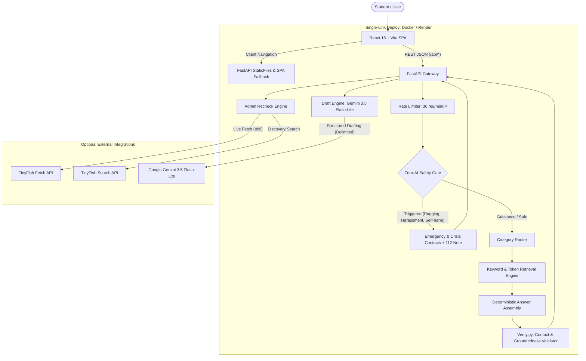

# RightWay — Student Rights & Grievance Navigator

**Hackathon:** Tiny Hacks 2026  
**Team:** Chill.exe (Anushika, Aman Saini)  
**Live Demo:** https://rightway-s7zc.onrender.com

RightWay is an open student rights and grievance navigator designed to eliminate information asymmetry between college students and university administrations. A student describes an issue in plain language (English, Hindi, or Hinglish). RightWay returns:
1. The applicable official regulatory rule (UGC 2023 regulations, AICTE, or institutional handbook).
2. The responsible office, committee, or ombudsperson to contact.
3. Actionable step-by-step procedures.
4. Official statutory time limits (e.g. mandatory 15-day grievance resolution).
5. Exact documents and receipts required.
6. Verbatim quotes and official source links with "last checked" dates.
7. A formal complaint draft formatted for submission to the institution.

Urgent safety triggers (ragging, sexual harassment, violence/threats, suicidal ideation) completely bypass AI and immediately surface emergency helplines and India's national 112 emergency service.

---

## What Happens When API Keys Are Not Configured

RightWay is designed to work out of the box even without external paid API keys:
- **No `GEMINI_API_KEY`**: The zero-AI safety gate, category routing, rule search, time limits, and procedures work 100% locally with zero external network calls. When a user requests a formal complaint draft, the backend falls back to a deterministic Python template, and the UI displays an AI banner showing `ai_used: false`.
- **No `TINYFISH_API_KEY`**: The application relies on the committed seed regulatory library (`data/library.json`), which contains verified excerpts from UGC 2023 regulations and national anti-ragging policies. Live web rechecking via `/api/recheck` will report that the key is missing while keeping existing records intact.

---

## Architecture



---

## Frontend Guide

RightWay's frontend is a lightweight Single Page Application (SPA) built with **React 18**, **Vite**, and **Tailwind CSS**. It is fully accessible, mobile-responsive, and contains zero emojis in button labels, using thin-stroke **Lucide** icons instead.

### 1. User Journey & Core Pages

| Route | Page | Purpose & User Features |
|---|---|---|
| `/` | **Home** | Grievance input bar with live character counter (max 1,000 chars), quick category filter pills, real-time safety warnings, and instant emergency modal trigger. |
| `/answer` | **Answer Navigator** | Displays the matched regulatory rule, responsible committee/office, actionable steps, strict time limits (e.g. 15 working days), documents needed, and verifiable source cards with verbatim quotes. Includes a one-click button to generate a formal complaint. |
| `/draft` | **Complaint Drafter** | Generates a formal grievance letter based on cited regulations and student details. Features an in-browser editable textarea, one-click copy to clipboard, and `.txt` file download. |
| `/sources` | **Sources & Verification** | Transparent index of all indexed regulatory documents with their SHA-256 content hashes, fetch dates, and status badges (`current`, `needs_recheck`, `changed`). Includes an Admin Recheck panel. |
| `/about` | **About & Mission** | Explains RightWay's mission under UGC 2023 regulations, data privacy guarantees, team credits, and transparent AI disclosures. |
| *Global* | **Emergency Modal** | Pinned red "Need help now?" emergency button in the navigation bar opening instant 24x7 crisis helplines, National Anti-Ragging numbers, and India's 112 note. |

### 2. Frontend State & Resilient API Client (`src/api.js`)

Free hosting tiers (like Render free instances) spin down when inactive. The frontend handles this gracefully:
- **Server Wake-Up Notice**: If an API request takes longer than 3.5 seconds, a notification banner displays: `"Waking the server (about 30 seconds)... Please wait while the instance starts up."`
- **Auto-Retry**: If a request encounters a transient network drop, it retries once before surfacing an error.
- **Same-Origin Default**: `VITE_API_URL` defaults to an empty string (`''`), allowing seamless single-link deployment where FastAPI serves the built frontend without CORS issues.
- **Length Enforcers**: Enforces strict client-side validation (1,000 chars for questions, 1,500 chars for complaints).

### 3. Running the Frontend Locally

```bash
cd frontend
npm install
cp .env.example .env
npm run dev
```
Runs at `http://localhost:5173`.

### 4. Running Frontend Tests (Vitest)
```bash
cd frontend
npm test
```
Runs 23 tests verifying app shell, navigation, emergency modal, answer cards, draft generation, and sources rechecking.

---

## Backend Guide

Built with **FastAPI**, **Pydantic v2**, **httpx**, and **google-genai**, following an atomic JSON file storage architecture (`data/library.json`).

### Running the Backend Locally

```bash
# From repository root:
pip install -r backend/requirements.txt

# Start FastAPI server on port 8000
python -m uvicorn app.main:app --app-dir backend --host 127.0.0.1 --port 8000 --reload
```
Interactive Swagger API documentation: **`http://127.0.0.1:8000/docs`**

### Autonomous Scripts (`backend/scripts/`)
- `python backend/scripts/discover_sources.py`: Autonomous TinyFish Search finding official college domains, grievance pages, and anti-ragging portals.
- `python backend/scripts/build_library.py`: Fetches and compiles verified regulation records into `data/library.json`.
- `python backend/scripts/smoke.py http://127.0.0.1:8000`: Automated smoke test checking health, emergency, normal search, and urgent safety response.

---

## Environment Variables

### Backend (`backend/.env`):
| Variable | Description | Default |
|---|---|---|
| `TINYFISH_API_KEY` | TinyFish API key for live search & fetch | *(Optional; seed library included)* |
| `GEMINI_API_KEY` | Google Gemini API key for complaint drafting | *(Optional; template fallback included)* |
| `GEMINI_MODEL` | Gemini Model ID | `gemini-3.5-flash-lite` |
| `ALLOWED_ORIGINS` | Permitted CORS origins | `*` |
| `ADMIN_TOKEN` | Bearer token required for `/api/recheck` | `change-this-secret-admin-token` |
| `UNIVERSITY_NAME` | Institution name for source discovery | `Vishveshwarya Group of Institutions, Greater Noida` |

### Frontend (`frontend/.env`):
| Variable | Description | Default |
|---|---|---|
| `VITE_API_URL` | Base URL of FastAPI backend | `""` (Empty string for same-origin deploy) |

---

## API Reference & Curl Examples

### 1. Root & SPA Fallback
```bash
curl -X GET http://127.0.0.1:8000/
```
Returns built frontend `index.html` (or API status JSON if running backend-only).

### 2. Health Check
```bash
curl -X GET http://127.0.0.1:8000/api/health
```
**Response (200 OK):**
```json
{
  "ok": true,
  "library_count": 5,
  "last_checked": "2026-11-07T12:00:00Z",
  "gemini_configured": true,
  "tinyfish_configured": false
}
```

### 3. Emergency Contacts
```bash
curl -X GET http://127.0.0.1:8000/api/emergency
```

### 4. Ask / Grievance Route (Normal Query)
```bash
curl -X POST http://127.0.0.1:8000/api/ask \
  -H "Content-Type: application/json" \
  -d '{
    "message": "How do I claim a refund for fee after cancelling my admission?",
    "category": "fee_refund"
  }'
```

### 5. Ask / Urgent Safety Trigger (Zero-AI)
```bash
curl -X POST http://127.0.0.1:8000/api/ask \
  -H "Content-Type: application/json" \
  -d '{"message": "Seniors are ragging me in hostel room 102 please help!"}'
```

### 6. Formal Complaint Drafting
```bash
curl -X POST http://127.0.0.1:8000/api/draft \
  -H "Content-Type: application/json" \
  -d '{
    "category": "fee_refund",
    "details": "Withdrew admission on 10th August. College is refusing caution money refund.",
    "record_ids": ["ugc-fee-refund-rule-2023"]
  }'
```

### 7. Regulatory Library Index
```bash
curl -X GET http://127.0.0.1:8000/api/library
```

### 8. Admin Recheck
```bash
curl -X POST http://127.0.0.1:8000/api/recheck \
  -H "Content-Type: application/json" \
  -H "X-Admin-Token: change-this-secret-admin-token" \
  -d '{"record_id": "ugc-fee-refund-rule-2023", "simulate_change": true}'
```

---

## Testing & Quality Assurance

### 1. Backend Test Suite (92 Tests — 100% Passing)
```bash
python -m pytest -q
```
Runs 92 automated tests across:
- `test_safety.py` (35 tests): Multilingual word boundary matching in English, Hindi, and Hinglish; false positive prevention (`bragging`, `dragging`); verified zero LLM calls.
- `test_tinyfish.py` (6 tests): Auth headers, SSE `COMPLETE` parsing, timeout/retry logic, dropping invented contact details, substring quote validation.
- `test_discover_sources.py` (4 tests): Domain filtering, regulator whitelisting, 20-page cap, and text length filtering.
- `test_library.py` (5 tests): Atomic read/writes, BM25 ranker, stop-word filtering, and SHA-256 change detection.
- `test_answer.py` (5 tests): Category routing, deterministic assembly, contact verification, and source metadata.
- `test_draft.py` (4 tests): Prompt injection delimiters, 429 rate limit fallback, placeholder preservation, and client-side throttle.
- `test_hardening.py` (6 tests): IP sliding-window rate limiting, secret scanning, CORS origin checks, and input boundary validation.
- `test_comprehensive_e2e.py` (27 tests): Full end-to-end endpoint tests across every normal, urgent, boundary, and unauthorized scenario.

### 2. Automated Smoke Test Script
```bash
python backend/scripts/smoke.py http://127.0.0.1:8000
```

---

## Deployment Guide

### Option 1: Single-Link Deploy on Render (Docker Web Service)
1. Push this repository to GitHub.
2. In [Render](https://render.com), create a new **Web Service** from your GitHub repo.
3. Select **Docker** environment (or let Render detect the root `render.yaml` and `Dockerfile`).
4. Set the following environment variables:
   - `GEMINI_API_KEY`: Your Google AI Studio API key
   - `TINYFISH_API_KEY`: Your TinyFish API key
   - `GEMINI_MODEL`: `gemini-3.5-flash-lite`
   - `ADMIN_TOKEN`: A secure random password
   - `ALLOWED_ORIGINS`: `*`
5. Render builds the React frontend in Stage 1, builds the Python backend in Stage 2, and serves both from a single URL.

### Option 2: Fallback Deploy on Hugging Face Docker Space
1. Create a new Space on [Hugging Face](https://huggingface.co/spaces).
2. Choose **Docker** as the Space SDK (Blank template).
3. Push this repository to your Space. The root `Dockerfile` automatically builds the frontend and exposes port 8000.
4. Under Space **Settings** -> **Variables and Secrets**, add `GEMINI_API_KEY`, `TINYFISH_API_KEY`, and `ADMIN_TOKEN`.

### Option 3: Split Deploy (Render Backend + Vercel Frontend)
- **Backend on Render**: Deploy `/backend` using `backend/requirements.txt` and `uvicorn app.main:app --host 0.0.0.0 --port $PORT`.
- **Frontend on Vercel**: Deploy `/frontend` setting `VITE_API_URL` to your Render backend URL. Preconfigured SPA rewrites are in `frontend/vercel.json`.

---

## AI Disclosure & Tools Used

See [AI_AND_TOOLS_DISCLOSURE.md](AI_AND_TOOLS_DISCLOSURE.md) for a complete audit of all libraries, models, cloud services, and AI coding assistants used in this project.

- **Zero-AI Safety Gate**: Queries containing urgent terms (ragging, violence, self-harm, harassment) never touch an LLM. Emergency contacts and static crisis resources are returned immediately.
- **Factual Grounding**: Rule answers, time limits, and contacts are assembled deterministically from verified institutional library records. The LLM is never permitted to invent phone numbers, emails, offices, or rules.
- **AI-Assisted Drafting**: Gemini (`gemini-3.5-flash-lite`) is used strictly to structure formal complaint drafts from cited regulations. Student input is treated as untrusted data within strict prompt delimiters.
- **Privacy Assurance**: The backend never logs student problem descriptions or personal details; request logs record only HTTP method, endpoint path, and status code.

---

## Team
**Chill.exe** — Anushika, Aman Saini  
Built for Tiny Hacks 2026.
